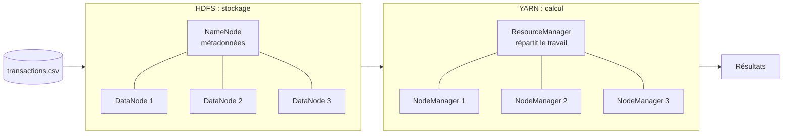

# Cluster Big Data Hadoop avec Docker

> Un mini-datacenter Big Data sur un seul PC : un cluster **Hadoop** de 8 nœuds, 4 traitements **MapReduce** en Python sur 100 000 transactions, et des **pannes simulées** pour prouver que les données survivent.


## En bref

| | |
|---|---|
| **Objectif** | Construire un vrai cluster Hadoop distribué, y analyser des données de ventes et tester sa résistance aux pannes |
| **Données** | 100 000 transactions e-commerce synthétiques (`transactions.csv`) |
| **Cluster** | 1 NameNode, 3 DataNodes, 1 ResourceManager, 3 NodeManagers, chacun dans son conteneur Docker |
| **Analyses** | Chiffre d'affaires par pays, par catégorie, par moyen de paiement et par mois |
| **Contexte** | Projet du cours Big Data, Ing1 Systèmes d'Information et Données |

## Ce que le projet démontre

- **Infrastructure as code** : tout le cluster se déploie avec 2 commandes (`Dockerfile` + `compose.yaml`), de façon reproductible.
- **Systèmes distribués** : stockage HDFS réparti sur 3 nœuds, avec réplication des données.
- **Traitement parallèle** : jobs MapReduce exécutés sur YARN, répartis sur plusieurs nœuds.
- **Fiabilité des résultats** : chaque job est vérifié par un script indépendant (résultats identiques).
- **Tolérance aux pannes** : arrêt volontaire de nœuds, observation et analyse du comportement du cluster.

## Architecture



Le stockage (HDFS) et le calcul (YARN) sont deux couches indépendantes : perdre un DataNode ne touche pas au calcul, perdre un NodeManager ne touche pas aux données.

## Résultats

### 1. Données stockées de façon distribuée
Le fichier de 6,78 Mio est découpé en **7 blocs**, chacun copié sur **2 DataNodes différents** (14 répliques au total). Le système de fichiers reste en état `HEALTHY`.

### 2. Quatre analyses MapReduce

| Job | Regroupement | Résultat |
|---|---|---|
| 1 | Pays | 5 pays |
| 2 | Catégorie | 4 catégories |
| 3 | Moyen de paiement | 4 moyens (Card, Cash, BankTransfer, MobileMoney) |
| 4 | Mois | 12 mois (2025-01 à 2025-12) |

Les montants sont calculés en **centimes entiers** pour éviter les erreurs d'arrondi des nombres flottants. Les 4 jobs ont été validés par un calcul indépendant, sans MapReduce : **résultats identiques**.

### 3. Résistance aux pannes

| Scénario | Ce qui s'est passé |
|---|---|
| **Un DataNode arrêté** | Détecté comme mort en ~40 s. HDFS recopie automatiquement les blocs concernés : aucune donnée perdue, le fichier reste lisible. |
| **Un NodeManager arrêté** | Le job relancé aboutit quand même, avec des résultats identiques, grâce aux 2 nœuds restants. |

## Démarrage rapide

Prérequis : Docker Desktop et environ 8 Go de RAM.

```bash
docker build -t hadoop-python:3.4.1 .
docker compose up -d
docker compose ps        # les 8 conteneurs doivent être "Up"
```

Interfaces web : NameNode sur http://localhost:9870, ResourceManager sur http://localhost:8088.

Le guide pas à pas (import des données, lancement des jobs, tests de panne) est dans [`docs/GUIDE_TECHNIQUE.md`](docs/GUIDE_TECHNIQUE.md).

## Structure du projet

```
├── Dockerfile          # image commune à tous les nœuds
├── compose.yaml        # déclare les 8 conteneurs
├── conf/               # configuration Hadoop (HDFS, YARN, MapReduce)
├── data/               # jeu de données
├── mapreduce/          # mappers, reducers et script de validation
├── results/            # sorties des 4 jobs
└── docs/               # guide technique détaillé
```

## Compétences mises en œuvre

`Hadoop` · `HDFS` · `YARN` · `MapReduce` · `Hadoop Streaming` · `Python` · `Docker` · `Docker Compose` · `Linux` · `Systèmes distribués` · `Tolérance aux pannes`

## Limites et pistes d'amélioration

- Les 8 conteneurs partagent un seul PC (processeur, mémoire, disque) : la tolérance aux pannes est **simulée**, pas équivalente à un vrai cluster de machines.
- Piste suivante : comparer avec **Apache Spark**, plus rapide pour ce type de traitement, ou déployer sur plusieurs machines réelles.

## Auteur

**Adama Fall** ·
